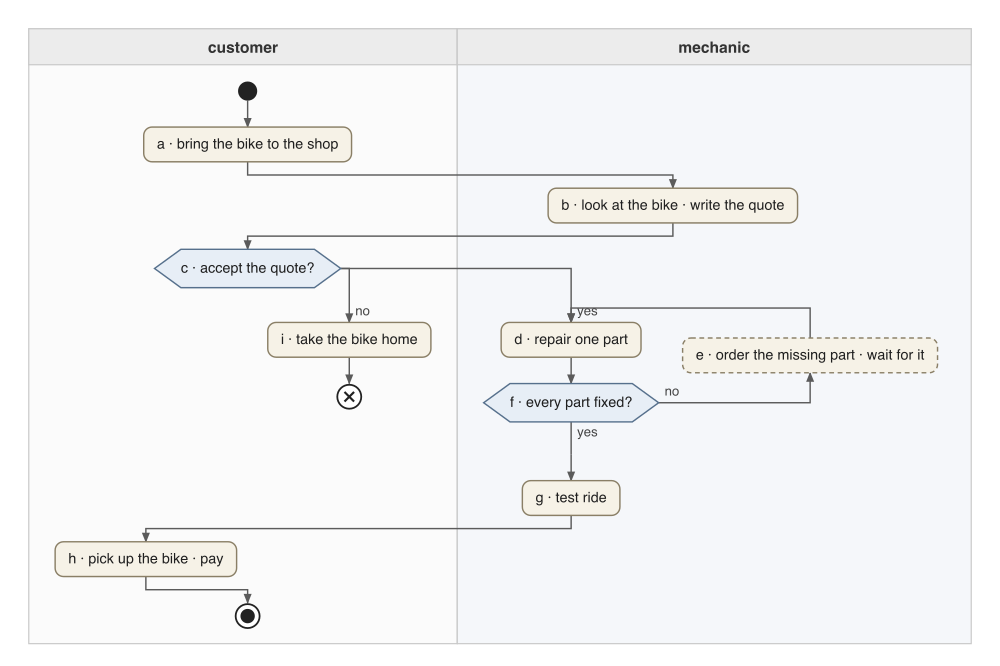
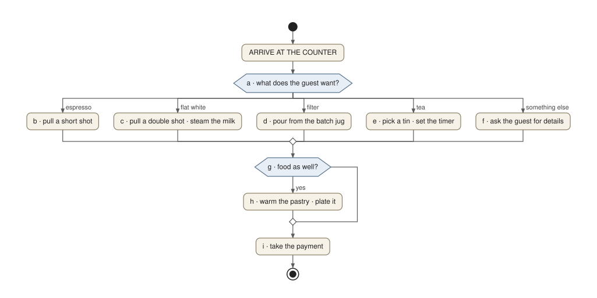
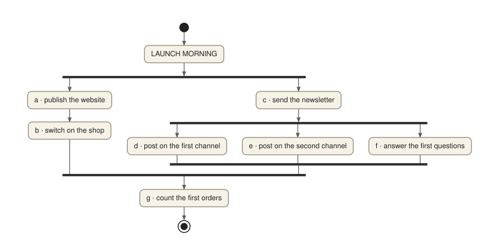

<p align="center">
  <h1 align="center">humanuml</h1>
  <p align="center"><strong>Flow diagrams as plain text</strong>: a model writes them right the first time</p>
</p>

<p align="center">
  
  
  
  
</p>

<br>

<p align="center">
Reads the PlantUML activity text of the Like A Human product flows.<br>
Errors by line and column, with a "did you mean" hint. JSON for agents. A fast SVG with its own layout.
</p>

<p align="center">
  
</p>

<p align="center"><sub>A bike repair, drawn by humanuml: two swimlanes and a loop with a backward step.</sub></p>

> **First spike.** It parses and draws the 125 real product flows of Like A Human (not published: examples in tests/examples). Notes, `split` and colours are not done yet.

---

### Build

```bash
cargo build --release      # ./target/release/humanuml
```

### Use

```bash
humanuml check flows/*.puml                # errors by line, with a hint
humanuml json  flows/coffee-order.puml         # nodes, edges and nesting as JSON
humanuml render flows/coffee-order.puml -o x.svg
```

A file is a `.puml` file, or a `.md` file with ```` ```plantuml ```` fences (line numbers stay the line numbers of the file).

---

### What you get

| | Command | Answer |
|---|---|---|
| ✅ | `humanuml check` | Pass or fail per diagram. One mistake gives one error, with file, line, column and a hint |
| 🧩 | `humanuml json` | Nodes with a stable id, branch labels on the edges, the nesting as a tree ([the shape](docs/model.md)) |
| 🎨 | `humanuml render` | SVG: nested boxes, real swimlanes, a flat `switch`, `data-node` on every node |
| ⚡ | the whole set | 125 fences render in 80 ms in one process (PlantUML native: 1.1 s) |

**An error a model can fix**

```text
tests/broken/14-wrong-closer.puml:5:1: error: expected `endwhile` to close the `while` from line 3, found `endif`
   |
 5 | endif
   | ^
   = hint: did you mean `endwhile`?
```

**A flat switch stays flat**: five cases draw as five branches under one line, not two on a shared line.

<p align="center">
  
</p>

**Forks, nested**

<p align="center">
  
</p>

---

### The text it reads

```text
@startuml example
start
:NOTHING SET UP;
if (a · a venue?) then (yes)
  :b · the venue text;
else (no)
  :c · a format;
endif
switch (d · what next?)
case (people)
  :e · people;
case (workshops)
  :f · workshops;
endswitch
repeat
  :g · try;
backward :h · say what went wrong;
repeat while (i · done?) is (no) not (yes)
stop
@enduml
```

`start` `stop` `end` · `:action;` (also over several lines) · `if` `elseif` `else` · `switch` `case` · `while` · `repeat` `backward` · `fork` `fork again` · `|lane|` · `note`

---

### Proof

| Check | Result |
|---|---|
| The 125 real flows (private) | all pass `check`, PlantUML agrees |
| 28 broken fences | all 28 give the error on the right line, with a hint |
| JSON counts | actions, decisions and lanes match the fence text, 124 of 124 |
| Render | every word and every node id present, 124 of 124 |

Numbers, what is not done and what draws worse than PlantUML: [docs/results.md](docs/results.md). Examples to try: [tests/examples](tests/examples).

### Layout of the repo

```
humanuml/
├── src/
│   ├── parser.rs     # the activity subset, errors with hints
│   ├── model.rs      # the graph: nodes, edges, tree
│   ├── layout.rs     # nested boxes, lanes, flat branches
│   ├── svg.rs        # SVG without a font library
│   └── font.rs       # Helvetica widths, so no browser is needed
├── tests/            # examples, 28 broken fences, the checks
└── docs/             # model.md, results.md
```

One crate, a library and a thin CLI, so a Node wrapper (napi or WASM) can follow. No network. No code of PlantUML or of any port was copied.
