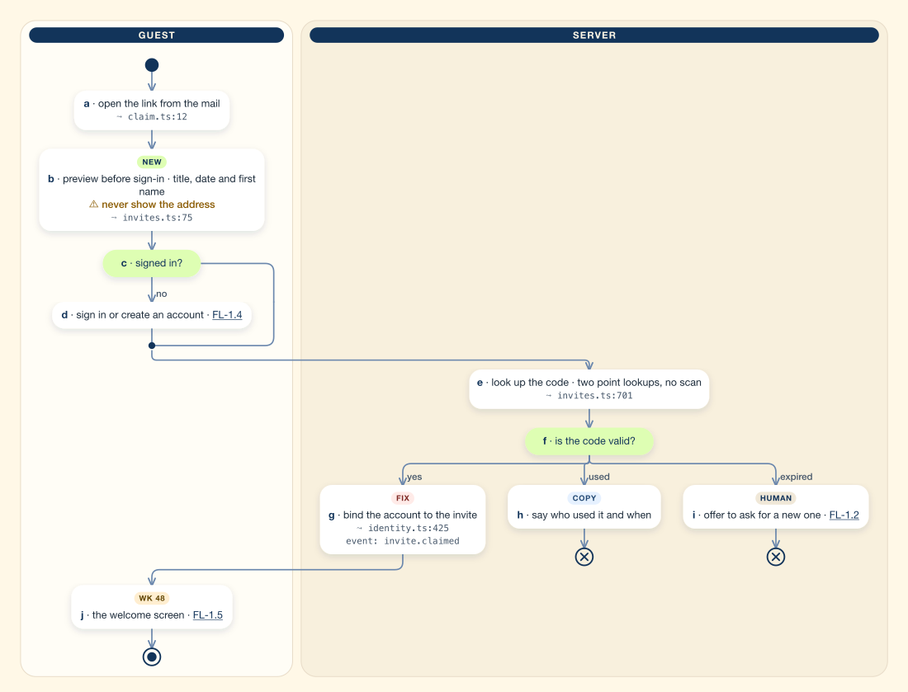
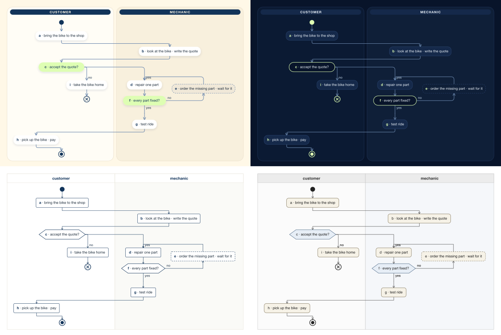
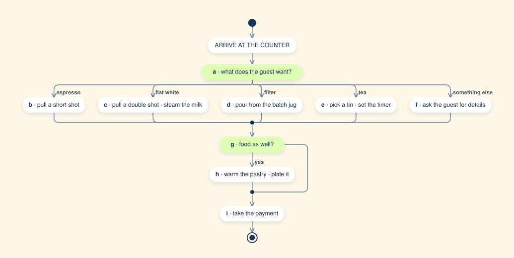

<p align="center">
  <h1 align="center">humanuml</h1>
  <p align="center"><strong>Flow diagrams as plain text</strong>: a model writes them right the first time</p>
</p>

<p align="center">
  
  
  
  
</p>

<br>

<p align="center">
The text is the source. A person and a model read the same lines.<br>
Every branch the code knows, every step with its status, where it lives and where it goes wrong.
</p>

<p align="center">
  
</p>

<p align="center"><sub><code>tests/examples/claim-invite.puml</code>, drawn by humanuml: status chips, citations, a pitfall, an event, links to other flows.</sub></p>

> **First spike.** It reads and draws the 125 real product flows of Like A Human (those stay private; the examples here are made up). Notes, `split` and colours per node are not done yet.

---

### Build

```bash
cargo build --release      # ./target/release/humanuml
```

### Use

```bash
humanuml check  flows/*.puml               # errors by line, with a hint
humanuml tree   flows/claim-invite.puml    # the flow as a text tree
humanuml json   flows/claim-invite.puml    # nodes, edges, marks and nesting
humanuml render flows/claim-invite.puml -o claim.svg [--theme soft|navy|ink|classic]
```

A file is a `.puml` file, or a `.md` file with ```` ```plantuml ```` fences (line numbers stay the line numbers of the file).

---

### What you get

| | Command | Answer |
|---|---|---|
| ✅ | `humanuml check` | Pass or fail per diagram. One mistake gives one error, with file, line, column and a hint |
| 🌳 | `humanuml tree` | The flow as a text tree: readable in a terminal, in a diff and on GitHub, with no renderer |
| 🧩 | `humanuml json` | Nodes with a stable id, the marks as fields, branch labels on the edges, the nesting ([the shape](docs/model.md)) |
| 🎨 | `humanuml render` | SVG: real swimlanes, a flat `switch`, chips and links, `data-node` on every node |
| ⚡ | the whole set | 125 flows render in 80 ms in one process (PlantUML native: 1.1 s) |

---

### Marks: what a step knows

The marks are words in the text of a step. PlantUML reads them as text; humanuml reads them as facts.

| Mark | Example | Says |
|---|---|---|
| status | `[v2]` `[new]` `[fix]` `[copy]` `[human]` `[old]` `[open]` `[wk 48]` | where the step stands |
| citation | `⤳ src/commands/invites.ts:701` | where the behaviour lives; a step without one is an intention |
| pitfall | `⚠ never show the address` | where it goes wrong if nobody pays attention |
| event | `event: invite.claimed` | the event that proves the step happened |
| reference | `FL-1.4` | another flow, drawn as a link |

```text
:b · preview before sign-in [new] · title, date and first name · ⚠ never show the address · ⤳ src/queries/invites.ts:75;
```

### The text tree

`humanuml tree tests/examples/claim-invite.puml`

```text
claim_invite
│
├── |guest|
├── ● start
├── a · open the link from the mail
│       ⤳ src/routes/claim.ts:12
├── b · preview before sign-in · title, date and first name  [new]
│       ⚠ never show the address
│       ⤳ src/queries/invites.ts:75
├── ◆ c · signed in?
│   ├── no
│   │   └── d · sign in or create an account · FL-1.4
│   └── (else) → on
├── |server|
├── e · look up the code · two point lookups, no scan
│       ⤳ src/commands/invites.ts:701
├── ◆ f · is the code valid?
│   ├── yes
│   │   └── g · bind the account to the invite  [fix]
│   │           ⤳ src/model/identity.ts:425
│   │           event: invite.claimed
│   ├── used
│   │   ├── h · say who used it and when  [copy]
│   │   └── ⊗ end
│   └── expired
│       ├── i · offer to ask for a new one · FL-1.2  [human]
│       └── ⊗ end
├── |guest|
├── j · the welcome screen · FL-1.5  [wk 48]
└── ◉ stop
```

### An error a model can fix

```text
tests/broken/14-wrong-closer.puml:5:1: error: expected `endwhile` to close the `while` from line 3, found `endif`
   |
 5 | endif
   | ^
   = hint: did you mean `endwhile`?
```

---

### Four looks

`soft` is the default: the brand on cream. `navy` is the dark mode. `ink` is for print. `classic` is close to PlantUML.

<p align="center">
  
</p>

**A flat switch stays flat**: five cases draw as five branches under one line.

<p align="center">
  
</p>

---

### Try the proof

Each line runs on what is in this repo.

```bash
humanuml check tests/examples/*.puml   # ok: 5 diagrams
python3 tests/check_broken.py          # 28/28 broken flows: error on the right line, with the hint
python3 tests/check_model.py           # the JSON counts match the text of every flow
python3 tests/check_render.py          # every word and every node id is in the SVG
cargo test                             # the marks
```

With PlantUML on the machine (`PLANTUML=/path/to/plantuml`), `check_broken.py` also lists where PlantUML accepts a mistake that humanuml refuses. Timings and open points: [docs/results.md](docs/results.md).

### Layout of the repo

```
humanuml/
├── src/
│   ├── parser.rs     # the activity subset, errors with hints
│   ├── marks.rs      # status, citations, pitfalls, events, references
│   ├── model.rs      # the graph: nodes, edges, tree
│   ├── tree.rs       # the text tree
│   ├── layout.rs     # nested boxes, lanes, flat branches
│   ├── svg.rs        # SVG and its themes, without a font library
│   └── font.rs       # Helvetica widths, so no browser is needed
├── tests/            # examples, 28 broken flows, the checks
└── docs/             # model.md, results.md, images
```

One crate, a library and a thin CLI, so a Node wrapper (napi or WASM) can follow. No network. No code of PlantUML or of any port was copied.
